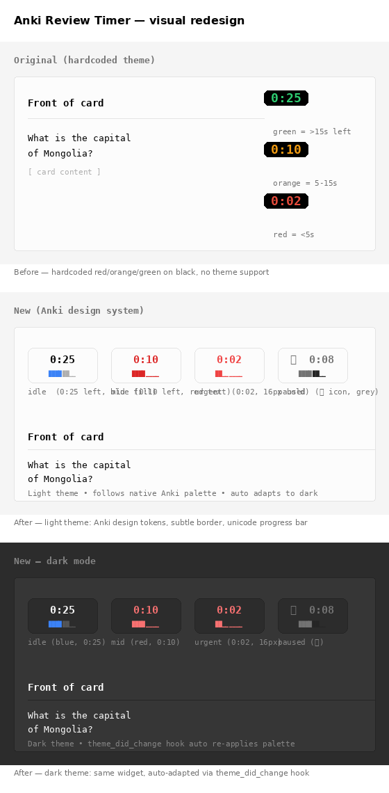

# Anki Review Timer (Redesigned & Auto-Grade)

A countdown timer add-on for Anki that helps you maintain a steady review pace and optionally auto-grades cards on timeout.

Click the timer to pause/resume.

> **This is an enhanced fork of [josh-freeman/anki-review-timer](https://github.com/josh-freeman/anki-review-timer).**
> It rewrites the visual design from scratch to follow Anki 25/26's native design system (matching day/night themes seamlessly), and adds automatic card grading (pass/fail) upon timeout so you can review completely hands-free.



## What's New & Changed

### 1. Independent Two-Phase Timing (Question Phase + Answer Phase)
- **正面阶段（Question Phase）**：卡片正面出现时，从 `timer_duration_seconds`（默认 30s）开始独立倒数。倒计时归零时自动翻开背面（若启用 `auto_show_answer`）。
- **背面阶段（Answer Phase）**：无论是用户主动按空格翻面，还是正面超时自动翻面，**只要翻到背面，计时器立刻重新开始一个全新的阅读时段**，从 `auto_grade_grace_seconds`（默认 30s）开始重新满格倒数！
- **自动过卡（Auto-Grade on Timeout）**：背面时段倒数归零时，自动执行评分（默认 `Again` / 1，即 fail）。在此期间随时手动按评价键打分或点击暂停。
- **阶段隔离，互不混淆**：彻底解耦“正面思考时间”与“背面核对时间”，保证每张卡在翻开后都拥有充裕且完整的独立阅读时段。

### 2. Visual Redesign
| | Original | This fork |
|---|---|---|
| Background | Hardcoded `rgba(0,0,0,0.7)` (always dark) | `CANVAS_OVERLAY` — adapts to Anki's day/night theme |
| Border | None | `1px BORDER_SUBTLE`, 8px corner radius |
| Color coding | Hardcoded `#e74c3c` / `#f39c12` / `#2ecc71` | Semantic Anki tokens — `FG` / `STATE_LEARN` / `ACCENT_DANGER` |
| Pause indicator | `\|\|` ASCII prefix | `⏸` pause glyph |
| Progress | None | 8-character unicode bar (`█` / `▁`) with two-tone coloring |
| Theme support | None — same colors in light/dark | Auto re-applies palette on `theme_did_change` |
| Font | `Menlo 18 Bold` | `Menlo 15 DemiBold` (16 in urgent state) |

## States

The widget transitions through five semantic states, all driven by Anki's own color tokens:

| State | When | Text color (light) | Text color (dark) |
|---|---|---|---|
| `idle` | remaining time > 50% | `FG` | `FG` |
| `mid` | remaining 25–50% | `STATE_LEARN` | `STATE_LEARN` |
| `urgent` | remaining ≤ 25% | `ACCENT_DANGER` (16 px) | `ACCENT_DANGER` (16 px) |
| `expired` | timer ran out | `FG_FAINT` | `FG_FAINT` |
| `paused` | user clicked the widget | `FG_DISABLED` | `FG_DISABLED` |

Progress bar fill uses `BORDER_FOCUS` in idle, then matches the text color in `mid` / `urgent`. Track color uses `FG_FAINT` in idle, then matches the text color for a single-color hint in the warn states.

## Requirements

- Anki 2.1.50+ (uses `theme.theme_manager.var()` and the `theme_did_change` hook)

## Installation

1. Download the latest release `.ankiaddon` from the Releases page, or clone this repo into your Anki add-ons directory:

   ```sh
   git clone https://github.com/FEI352/anki-review-timer.git \
       ~/.local/share/Anki2/addons21/anki-review-timer
   ```

2. Restart Anki.

## Configuration

See [`config.md`](config.md) for full parameter details. The default settings in `config.json` are:

```json
{
    "timer_duration_seconds": 30,
    "auto_show_answer": true,
    "show_pause_indicator": true,
    "auto_grade_ease": 1,
    "auto_grade_grace_seconds": 30,
    "front_color": "",
    "back_color": "green"
}
```

- **`timer_duration_seconds`** (default `30`): Countdown duration in seconds before the timer triggers timeout actions.
- **`auto_show_answer`** (default `true`): Automatically reveals the answer when the countdown expires. (Forced on when `auto_grade_ease` is configured).
- **`show_pause_indicator`** (default `true`): Displays the `⏸` icon prefix when the timer is paused.
- **`auto_grade_ease`** (default `1`): Grade applied upon expiration. `0` = off (only reveals answer), `1` = Again (fail, default), `2` = Hard, `3` = Good (pass), `4` = Easy.
- **`auto_grade_grace_seconds`** (default `30`): Reading grace period (in seconds) between answer revelation and the automatic rating firing.
- **`front_color`** (default `""`): Color scheme for the front question phase. `""` uses Anki's dynamic semantic tokens (`FG` -> `STATE_LEARN` -> `ACCENT_DANGER`), or choose from presets (`"blue"`, `"green"`, `"yellow"`, `"orange"`, `"purple"`) or custom hex strings (e.g. `"#3b82f6"`).
- **`back_color`** (default `"green"`): Color scheme for the back answer phase. Distinguishes answer review from question thinking (`"green"` / `"yellow"` / `"orange"` / `"purple"` / `"blue"`, or custom `#RRGGBB` hex string).

## Credits

- Original add-on by [josh-freeman](https://github.com/josh-freeman/anki-review-timer) (MIT).
- Visual redesign uses Anki's [_aqt.colors](https://github.com/ankitects/anki/blob/main/qt/_aqt/colors.py) token system and the [ThemeManager.var()](https://github.com/ankitects/anki/blob/main/qt/aqt/theme.py) helper.

## License

MIT — see [`LICENSE`](LICENSE).
